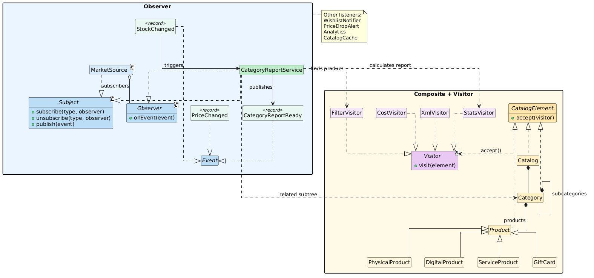

# Online Marketplace: Observer and Visitor
## Assignment 6

Aldiyar Kairollin | SE-2539

A small Java 17 marketplace demonstrating Observer, Visitor, and their integration. JUnit 5 is the only test dependency.

## Run

```bash
./gradlew run
./gradlew run --args="4"
./gradlew test
```

The demo uses three producer tasks on an `ExecutorService`; the optional argument sets the pool size (minimum 3). It waits for all tasks and shuts down the pool gracefully.

## Design

- **Observer:** `MarketSource<E>` implements our generic `Subject<E>` interface and pushes immutable, typed events to `Observer<E>` listeners. Push supplies old and new values without requiring listeners to read mutable source state. Separate price and stock sources notify `WishlistNotifier`, `PriceDropAlert`, `Analytics`, `CatalogCache`, and `CategoryReportService`. Listeners can subscribe or unsubscribe during a callback. A concurrent registry with per-type `CopyOnWriteArrayList` keeps notifications safe without locking the whole source.
- **Visitor:** `Catalog → Category → subcategory → Product` is a Composite with two container types and four leaf types: physical, digital, service, and gift card. Each element calls `visitor.visit(this)` through `accept`, giving double dispatch. Visitors own traversal so each operation controls how it combines results: `CostVisitor` calculates tax or shipping, `StatsVisitor` accumulates counts, `FilterVisitor` returns matching products, and `XmlVisitor` exports nested XML. Element classes hold the catalog data.
- **Integration:** A stock event reaches `CategoryReportService`, which finds the product and runs `StatsVisitor` only on the event's category subtree. The service then publishes a `CategoryReportReady` event. Updating stock, calculating the report, and publishing it are serialized per category so concurrent reports remain consistent. Shared counters, caches, queues, and product values use concurrent or atomic types.
- **Composition:** `Main` builds the object graph and injects dependencies through constructors; business classes do not create their own services.

## Tests

There are 16 JUnit 5 tests. They include hand-calculated tax and shipping results, a four-producer stress test with exactly 4,000 events, and a concurrent category-report test.

## Visitor trade-off

- Commit `2d61bef` added `FilterVisitor.java` and `XmlVisitor.java` only. Adding a new operation required no changes to element classes.
- Commit `ed82283` added `GiftCard.java` and changed `Visitor.java`, `CostVisitor.java`, `StatsVisitor.java`, `FilterVisitor.java`, and `XmlVisitor.java`. Adding a new element type requires an overload in the visitor contract and support in every visitor; this cost grows with the number of visitors.

## UML


